# Strange Attractor Screensaver

A mesmerizing macOS screen saver that simulates and renders **strange attractors** — chaotic dynamical systems that trace infinitely intricate, never-repeating paths in 3D space.

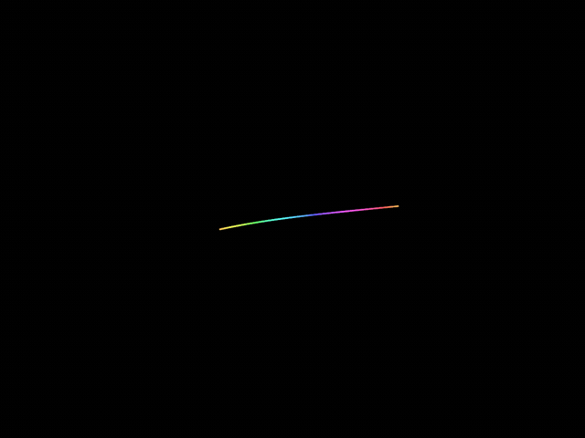

Every launch picks a **random attractor** from a catalog of 12 classic chaotic systems, randomizes its parameters and camera, and draws the trajectory as a glowing gradient trail. The live formulas and parameter values are displayed in the corner — a screen saver that is also a small piece of mathematical art.

## Features

- **12 strange attractors** — Lorenz, Aizawa, Rössler, Thomas, Chen, Lü, Chua, Halvorsen, Moore–Spiegel and the Sprott family (see [the catalog](#the-attractor-catalog)).
- **Data-driven design** — attractors are described in a single JSON catalog (formulas, parameter ranges, initial states), not in code. Adding a new one requires no code changes.
- **Runge–Kutta 4 integration** of the ODE system, with the number of steps per frame bounded so a sleep/wake stall cannot freeze the animation.
- **Self-healing** — a watchdog detects degenerate runs (divergence, collapse, stable periodic orbits, non-finite states) and silently restarts with a fresh random selection.
- **4 trail color modes** — rainbow along the trail, monochrome aging, depth from the camera, or spatial coloring.
- **Formula parsing at runtime** — `dX/dY/dZ` equations are parsed from strings, so the catalog stays pure data.
- **No runtime dependencies** — pure Swift on top of Apple's Foundation, SceneKit and AppKit. The test target uses Swift Testing only.
- **Demo app with CLI** — run any attractor with explicit parameters for exploration and debugging.

## The Attractor Catalog

| Attractor | Equations | Parameters | Preview |
|---|---|---|---|
| **Lorenz** | `dx = a(y − x)`<br>`dy = x(r − z) − y`<br>`dz = xy − bz` | a, b, r | 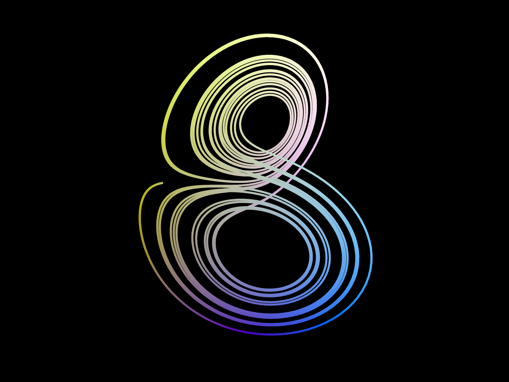 |
| **Aizawa** | `dx = (z − b)x − dy`<br>`dy = dx + (z − b)y`<br>`dz = c + az − z³/3 − (x² + y²)(1 + ez) + fz x³` | a, b, c, d, e, f | 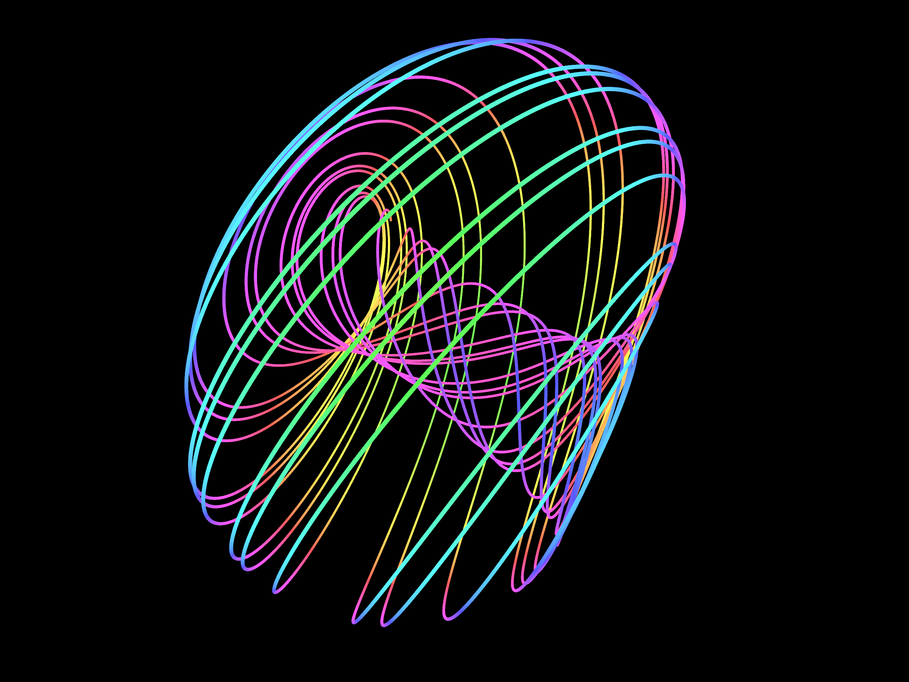 |
| **Rössler** | `dx = −y − z`<br>`dy = x + ay`<br>`dz = b + z(x − c)` | a, b, c | 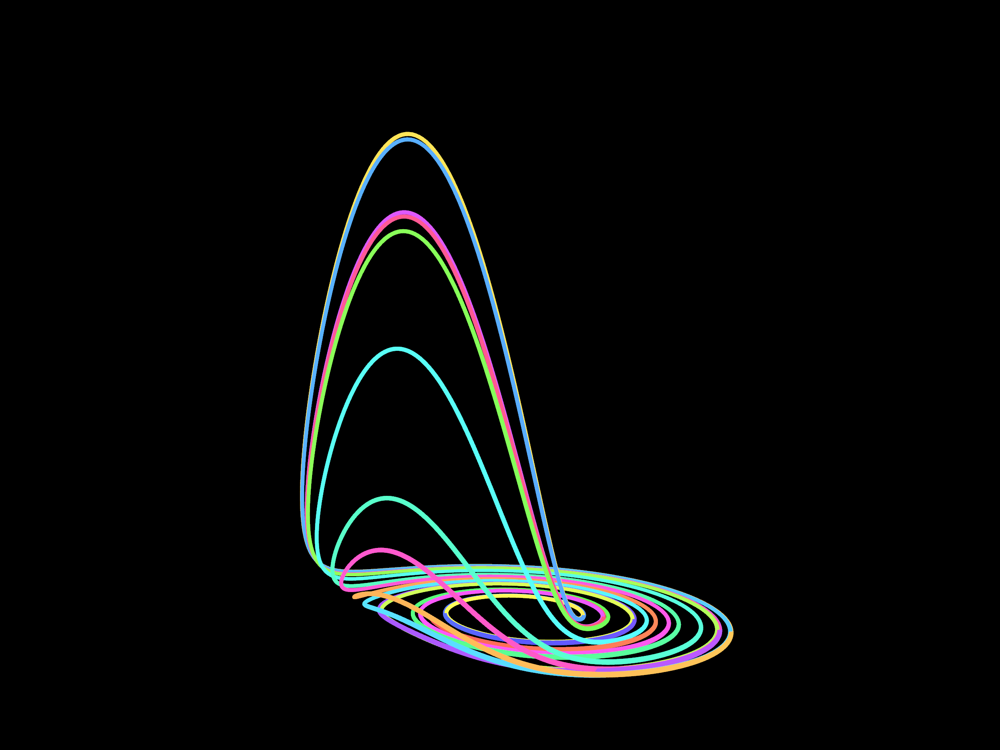 |
| **Thomas** | `dx = sin(y) − bx`<br>`dy = sin(z) − by`<br>`dz = sin(x) − bz` | b | 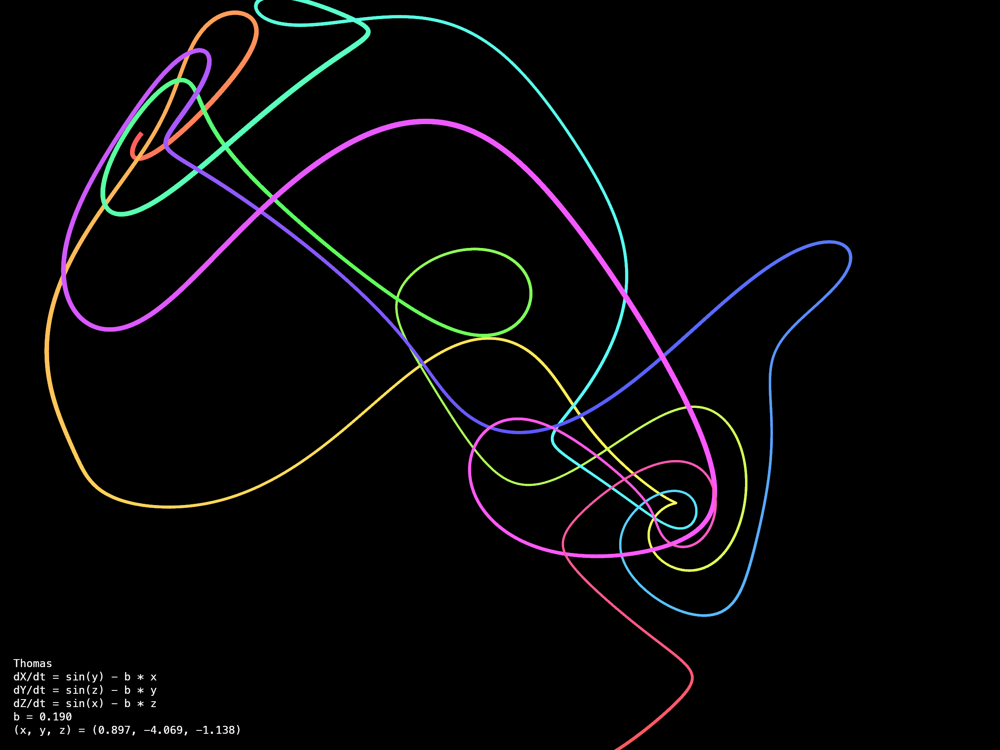 |
| **Chen** | `dx = a(y − x)`<br>`dy = (c − a)x − xz + cy`<br>`dz = xy − bz` | a, b, c | 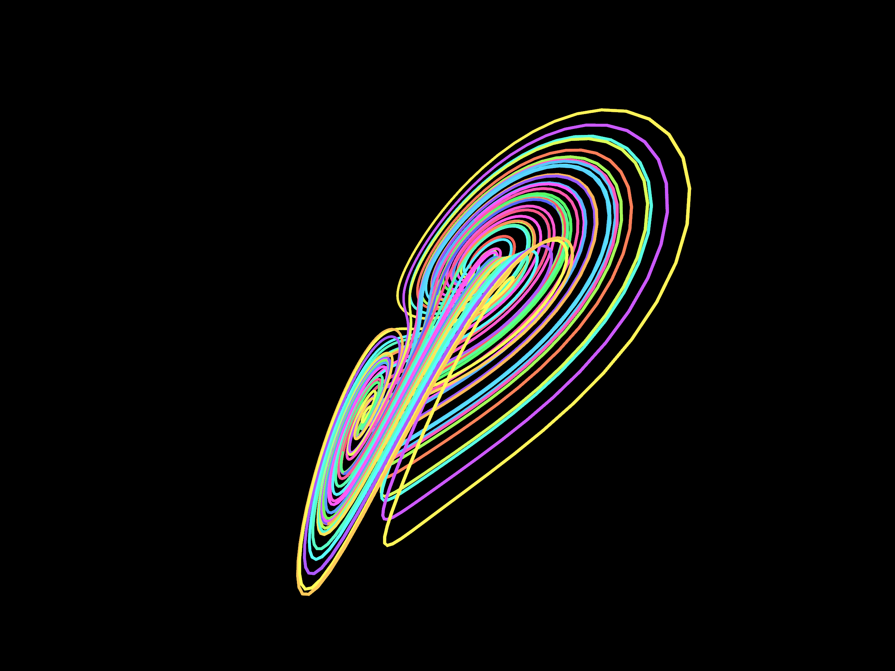 |
| **Lü** | `dx = a(y − x)`<br>`dy = −xz + cy`<br>`dz = xy − bz` | a, b, c | 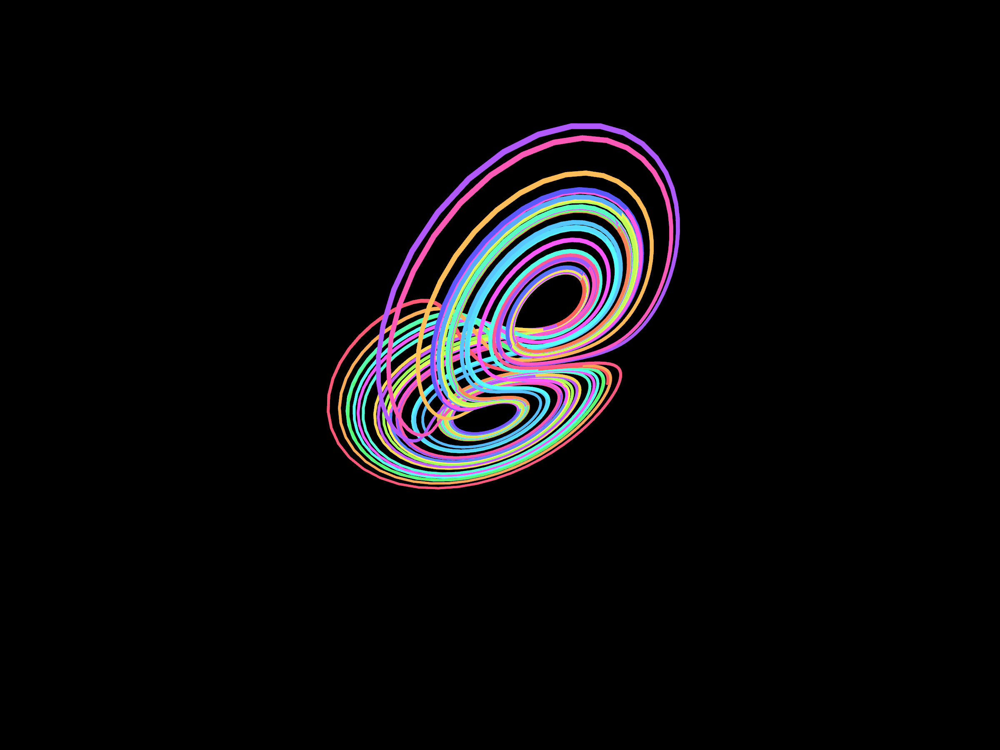 |
| **Chua** (double scroll) | `dx = α(y − x − f(x))`<br>`dy = x − y + z`<br>`dz = −βy` with piecewise-linear `f(x)` | α, β, m₀, m₁ | 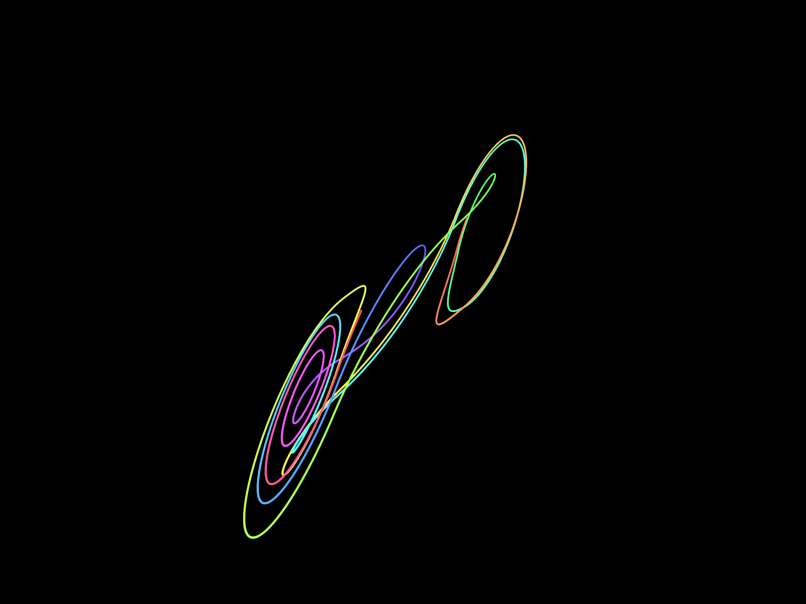 |
| **Halvorsen** (cyclically symmetric) | `dx = −ax − 4y − 4z − y²`<br>`dy = −ay − 4z − 4x − z²`<br>`dz = −az − 4x − 4y − x²` | a | 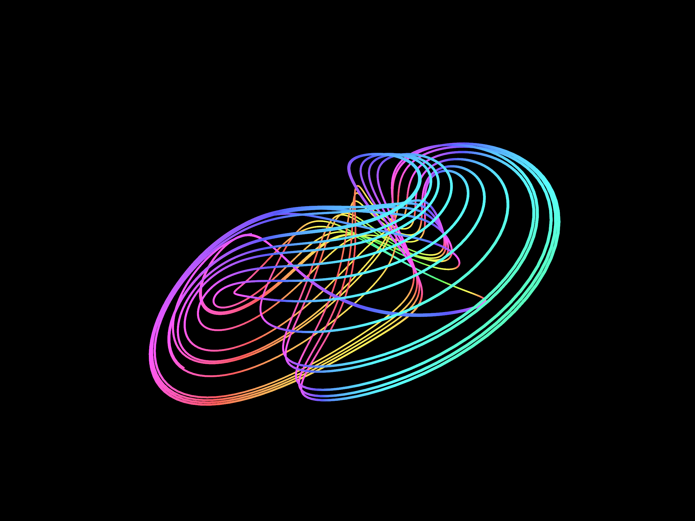 |
| **Moore–Spiegel** (2nd-order oscillator) | `dx = 10y`<br>`dy = 35z`<br>`dz = −z − (T − R + Rx²)y/35 − (T/350)x` | R, T | 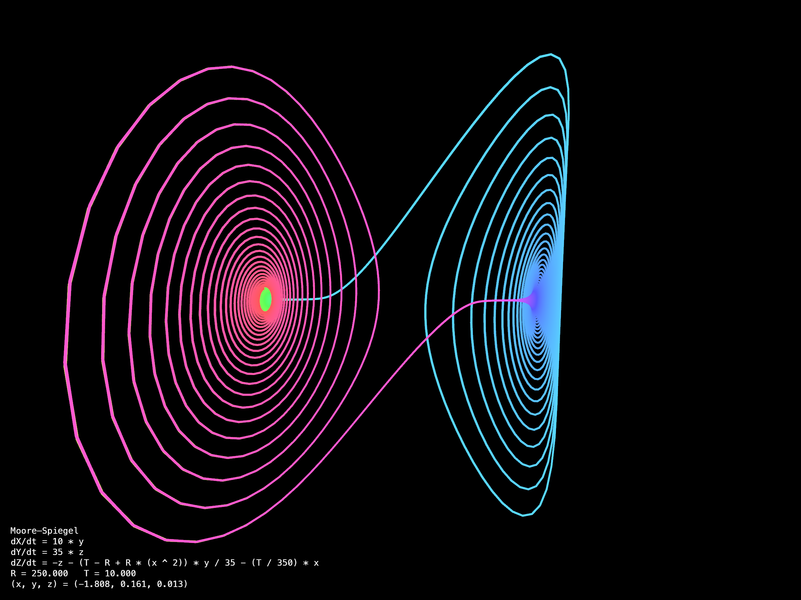 |
| **Sprott A** | `dx = y`<br>`dy = −x + yz`<br>`dz = 1 − y²` | fixed | 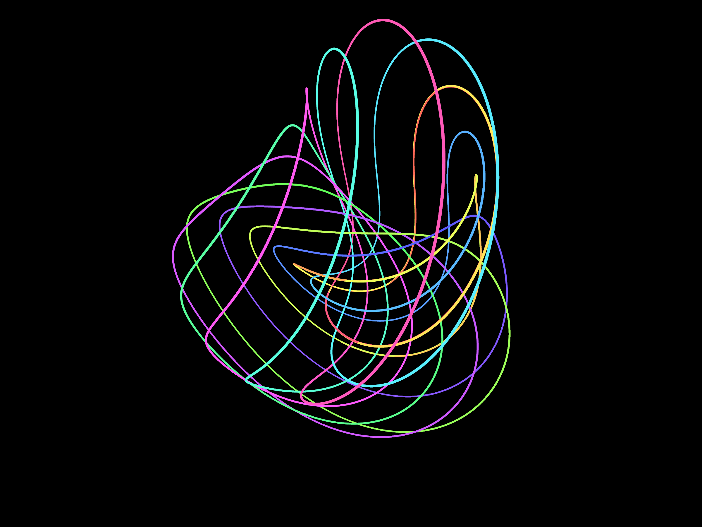 |
| **Sprott B** | `dx = yz`<br>`dy = x − y`<br>`dz = 1 − xy` | fixed | 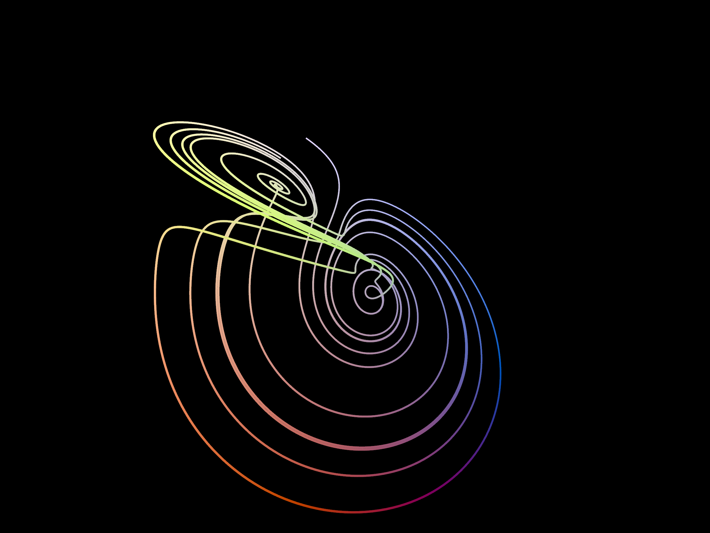 |
| **Sprott C** | `dx = yz`<br>`dy = x − y`<br>`dz = 1 − x²` | fixed | 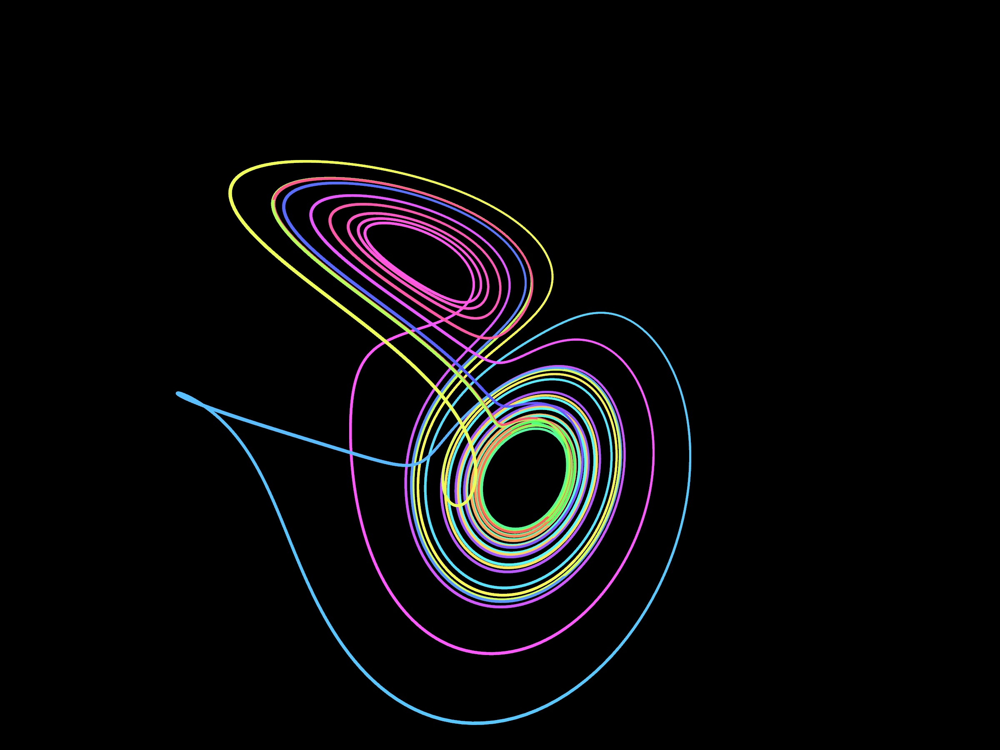 |

Each attractor's parameters and simulation hyperparameters (step size, trail length, camera speed, color cycle speed) are randomized within curated ranges in [`Core/Sources/AttractorCore/Resources/attractors.json`](Core/Sources/AttractorCore/Resources/attractors.json). The catalog is validated when it loads — formulas must parse, ranges must be sane and only implemented functions are allowed — and unit tests integrate every bundled entry. Chaotic families with tiny basins of attraction (e.g. Sprott D–J, Rabinovich–Fabrikant) are excluded because they diverge from random starts.

## Installation

### From a release (recommended)

1. Download `AttractorSaver.saver.zip` (and its `.sha256` file) from the latest [release](https://github.com/xekchansky/strange-attractor-screensaver/releases); unzip it (Safari does this on its own). Optionally verify the download:

   ```bash
   shasum -a 256 -c AttractorSaver.saver.zip.sha256
   ```

2. The bundle is ad-hoc code-signed and **not notarized**, so Gatekeeper will refuse a downloaded copy with _"Apple could not verify…"_. Clear the quarantine flag first:

   ```bash
   xattr -r -d com.apple.quarantine ~/Downloads/AttractorSaver.saver
   ```

   If a Homebrew `xattr` shadows the system one and fails with `bad interpreter`, call `/usr/bin/xattr` explicitly. Alternatively, try to open the bundle once and then allow it via **System Settings → Privacy & Security → Open Anyway**.

3. Double-click `AttractorSaver.saver` — macOS opens it in **System Settings → Wallpaper → Screen Saver**. Alternatively, copy it to `~/Library/Screen Savers/`.
4. Select **AttractorSaver** in the screen saver list.

macOS 26 additionally requires the bundle to carry a signature (ad-hoc is enough) — an unsigned `.saver` is killed by the host with `Code Signature Invalid`.

### Build from source

Requires macOS with Xcode (or Xcode Command Line Tools) and [xcodegen](https://github.com/yonaskolb/XcodeGen):

```bash
git clone https://github.com/xekchansky/strange-attractor-screensaver.git
cd strange-attractor-screensaver

# Run the core unit tests (no Xcode required)
cd Core && swift test && cd ..

# Build and install the .saver bundle
cd Host
xcodegen generate
xcodebuild -project AttractorHost.xcodeproj -scheme AttractorSaver \
  -configuration Release -derivedDataPath /tmp/host-dd build
mkdir -p ~/Library/Screen\ Savers
rm -rf ~/Library/Screen\ Savers/AttractorSaver.saver
ditto /tmp/host-dd/Build/Products/Release/AttractorSaver.saver \
      ~/Library/Screen\ Savers/AttractorSaver.saver
```

To produce the distributable zip and its checksum, run
[`scripts/package_release.sh`](scripts/package_release.sh).

### Try it without installing: the demo app

A standalone demo app lets you run a specific attractor with explicit parameters — handy for exploring parameter space:

```bash
cd Demo && swift run AttractorDemo --attractor aizawa
```

The demo needs a logged-in GUI session: it opens a real window, and both the
live view and the PNG capture path use Metal.

CLI options:

```text
-a, --attractor <id>       pick a specific attractor (see --help for the list)
-p, --param <name>=<value> override a parameter (repeatable, requires --attractor)
--step <v>                 integration step size
--speed <v>                simulation speed multiplier
--cam-speed <v>            camera rotation speed
--trail-color-speed <v>    trail color cycle speed
--trail-length <n>         trail length in points
--color-mode <mode>        trail | age | depth | spatial
--screenshot <path>        capture one PNG of a warmed-up scene, then exit
--record <dir>             record PNG frames (for GIF assembly), then exit
--record-seconds <v>       recording duration (default 4)
--frame-stride <n>         capture every n-th frame (default 2)
--capture-scale <n>        snapshot resolution multiplier (default 2)
--warmup-steps <n>         integration steps before the capture (default 60000)
--cam-azimuth <deg>        start the camera orbit at this azimuth (default: random)
--cam-elevation <deg>      camera height above the horizontal plane (default: 36)
--initial-state x,y,z      start the integration at this point
```

## How It Works

```
attractors.json ──▶ AttractorCatalog ──▶ Randomizer ──▶ AttractorSelection
                                                              │
                                                              ▼
   SceneKit view ◀── TraceRenderer ◀── AttractorEngine ◀── AttractorModel
   (camera, trail)                      ▲              (recursive-descent
                                        │                formula parser)
                                  ODESolver (RK4)
```

- **`Core/`** — `AttractorCore`: pure, UI-free SPM module. Data model, formula parser (recursive descent — `NSExpression` cannot do `sin`/`abs`), RK4 solver, engine with a ring-buffer trail, randomizer, and a health monitor that watches every integrated state.
- **`Render/`** — `AttractorRender`: SceneKit rendering — gradient polyline trail, orbiting camera with auto-framing, formula overlay. Shared by the demo and the screen saver.
- **`Demo/`** — `AttractorDemo`: a standalone AppKit app for interactive runs and offscreen frame capture (`--screenshot` / `--record`).
- **`Host/`** — the screen saver targets: the classic `.saver` bundle people install, plus an experimental `.appex` variant for embedding in a container app. Both are generated with xcodegen from `Host/project.yml`.

The screen saver re-creates the whole scene when the watchdog detects a bad run (e.g. the trajectory collapses to a point or settles into a periodic loop), so it never sits frozen on a broken frame.

## Troubleshooting

- **The screen saver does not appear in System Settings.** Re-copy the bundle
  with `ditto` (not `cp -R`) and restart the wallpaper agent:
  `killall WallpaperAgent`. The system caches the screen saver list.
- **The screen saver shows "Invalid Page" or a black preview.** A stale copy is
  usually still loaded by the host. Quit System Settings, remove the bundle,
  copy it again and reopen the settings pane.
- **The download is blocked by Gatekeeper.** See the quarantine step in
  [Installation](#installation).

## Requirements and tested setup

- macOS 13 or newer, Apple Silicon or Intel.
- Tested on macOS 26 (Apple Silicon): Xcode 26 toolchain, Swift 6.3.
- Building the screen saver needs Xcode and [xcodegen](https://github.com/yonaskolb/XcodeGen);
  the core tests also work with Command Line Tools alone.

## Notes & Known Issues

- Installing an **unsigned** `.saver` on macOS 26 can wedge the session's
  global hotkeys (Cmd+Tab, input switching) until reboot — see
  [the write-up](.serena/memories/macos_input_lockup.md). Release bundles are
  ad-hoc signed, which the system accepts.

## Documentation

- [README in Russian](README.ru.md)
- Contributor and coding-agent notes: [`AGENTS.md`](AGENTS.md)
- Security policy: [`SECURITY.md`](SECURITY.md)
- Capture script for documentation assets: [`docs/capture_all.sh`](docs/capture_all.sh)
- Release packaging: [`scripts/package_release.sh`](scripts/package_release.sh)

## License

[MIT](LICENSE) © Khakayu Alexandr
