# Strange Attractor Screensaver

Захватывающий скринсейвер для macOS, который симулирует и рендерит **странные аттракторы** — хаотические динамические системы, рисующие бесконечно сложные, никогда не повторяющиеся траектории в трёхмерном пространстве.

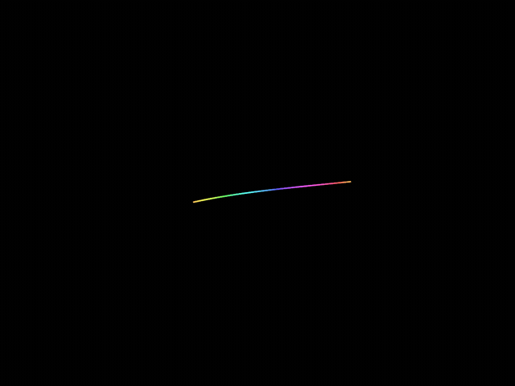

При каждом запуске случайно выбирается один из **12 классических хаотических аттракторов**, случайным образом подбираются его параметры и камера, а траектория рисуется светящейся градиентной линией. В углу экрана показываются живые формулы и текущие значения параметров — заставка, которая одновременно является небольшим математическим арт-объектом.

→ English version: [README.md](README.md)

## Возможности

- **12 странных аттракторов** — Лоренц, Айзава, Рёсслер, Томас, Чен, Лу, Чуа, Халворсен, Мур–Шпигель и семейство Спротта (см. [каталог](#каталог-аттракторов)).
- **Данные вместо кода** — аттракторы описаны в едином JSON-каталоге (формулы, диапазоны параметров, начальные состояния), а не в коде. Новый аттрактор добавляется без единой строчки кода.
- **Интегрирование Рунге–Кутты 4-го порядка** с адаптивным пошаговым планированием.
- **Самолечение** — сторожевой механизм распознаёт вырожденные запуски (расходимость, схлопывание в точку, устойчивые периодические орбиты, нефинитные состояния) и бесшовно перезапускает симуляцию с новым случайным набором.
- **4 цветовых режима трейла** — радуга вдоль траектории, монохром по устареванию, глубина от камеры, окраска по координатам.
- **Парсинг формул в рантайме** — уравнения dX/dY/dZ разбираются из строк, поэтому каталог остаётся чистыми данными.
- **Ноль сторонних зависимостей** — только Swift, Foundation, SceneKit и AppKit.
- **Демо-приложение с CLI** — запуск любого аттрактора с явными параметрами для исследования и отладки.

## Каталог аттракторов

| Аттрактор | Уравнения | Параметры | Превью |
|---|---|---|---|
| **Лоренц** | `dx = a(y − x)`<br>`dy = x(r − z) − y`<br>`dz = xy − bz` | a, b, r | 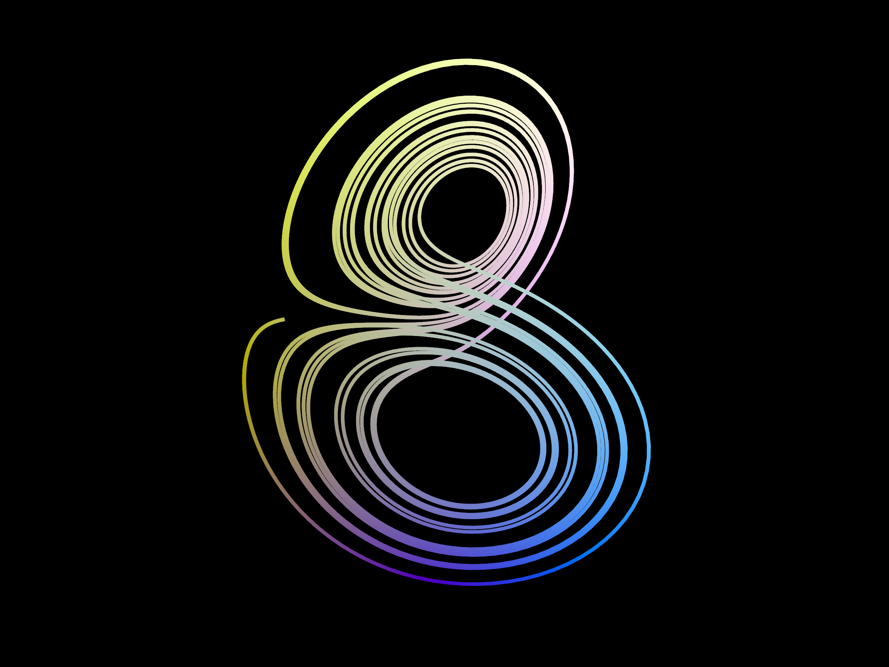 |
| **Айзава** | `dx = (z − b)x − dy`<br>`dy = dx + (z − b)y`<br>`dz = c + az − z³/3 − (x² + y²)(1 + ez) + fz x³` | a, b, c, d, e, f | 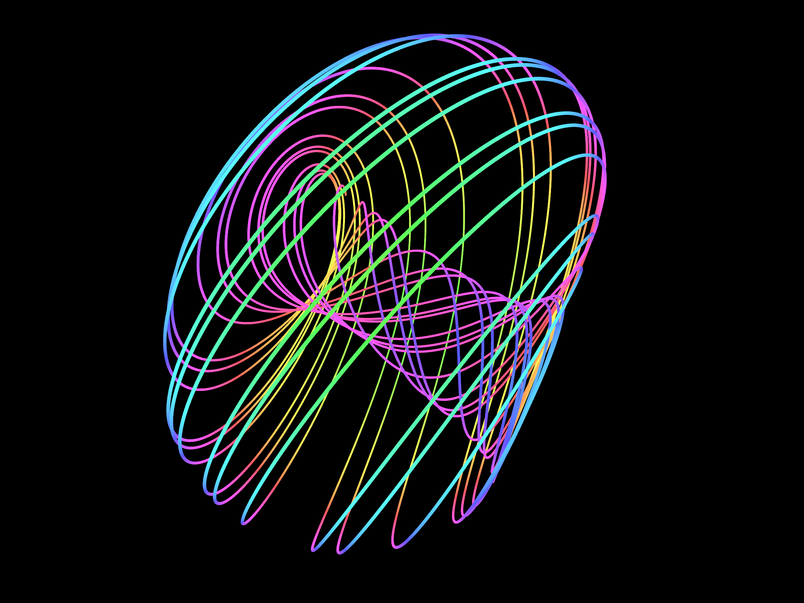 |
| **Рёсслер** | `dx = −y − z`<br>`dy = x + ay`<br>`dz = b + z(x − c)` | a, b, c | 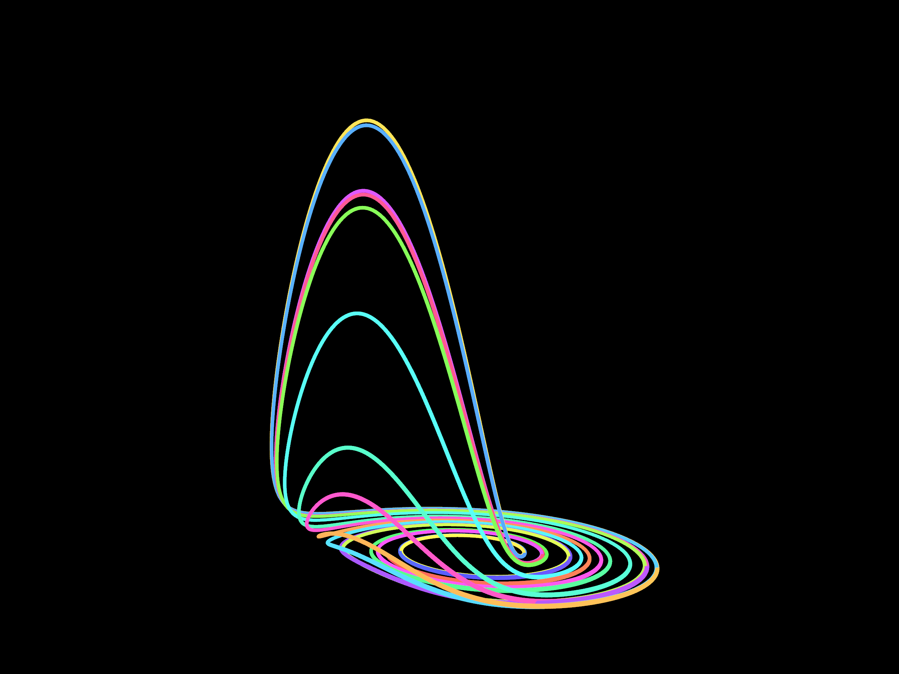 |
| **Томас** | `dx = sin(y) − bx`<br>`dy = sin(z) − by`<br>`dz = sin(x) − bz` | b | 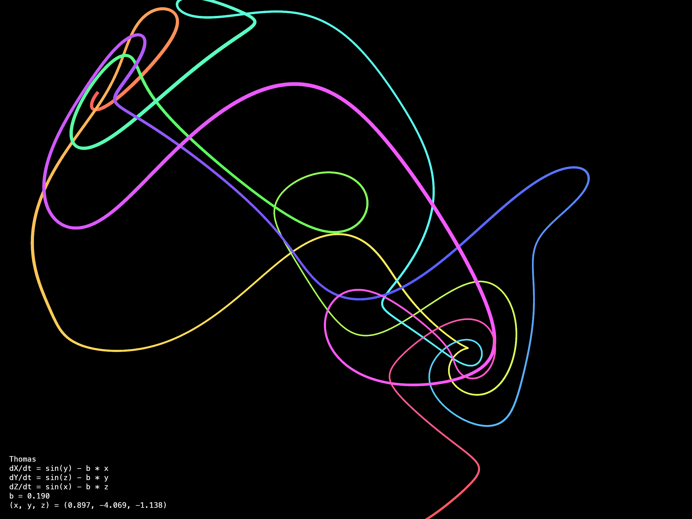 |
| **Чен** | `dx = a(y − x)`<br>`dy = (c − a)x − xz + cy`<br>`dz = xy − bz` | a, b, c | 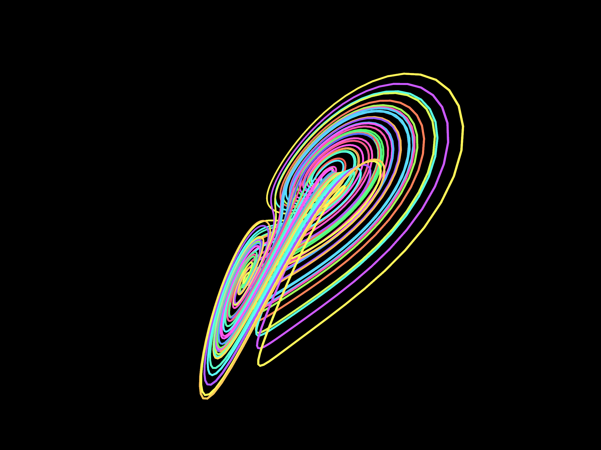 |
| **Лу** | `dx = a(y − x)`<br>`dy = −xz + cy`<br>`dz = xy − bz` | a, b, c | 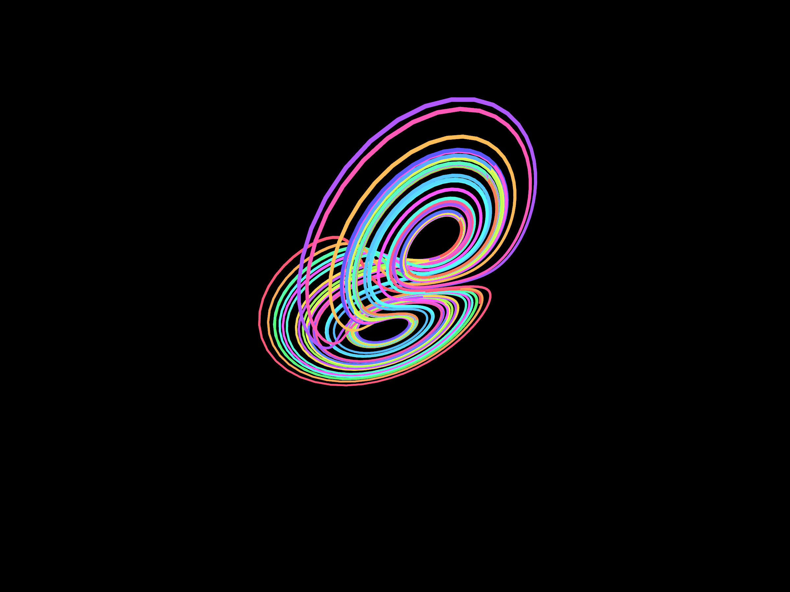 |
| **Чуа** (двойной скролл) | `dx = α(y − x − f(x))`<br>`dy = x − y + z`<br>`dz = −βy` с кусочно-линейной `f(x)` | α, β, m₀, m₁ | 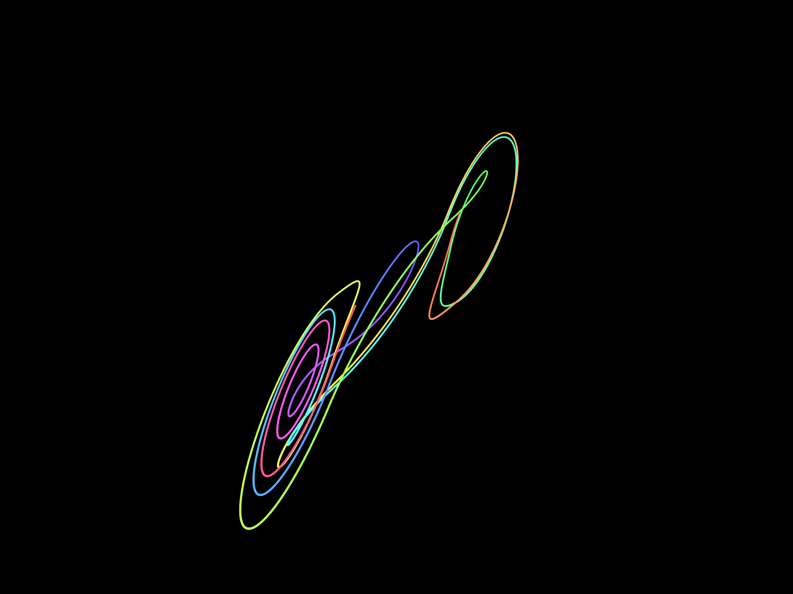 |
| **Халворсен** (циклически-симметричный) | `dx = −ax − 4y − 4z − y²`<br>`dy = −ay − 4z − 4x − z²`<br>`dz = −az − 4x − 4y − x²` | a | 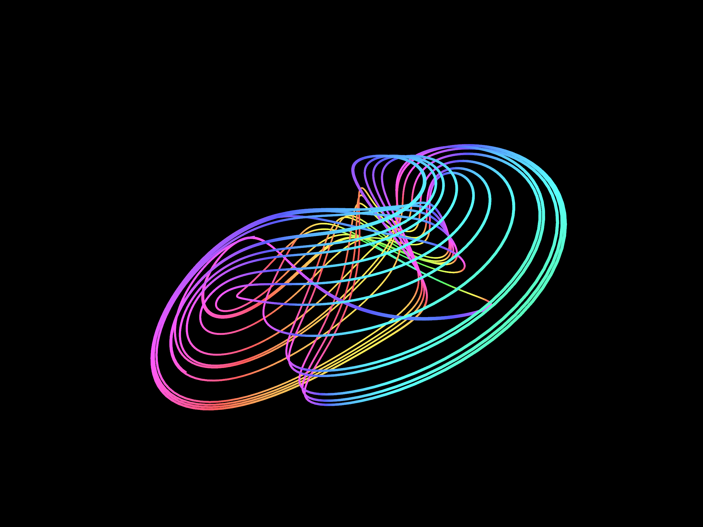 |
| **Мур–Шпигель** (осциллятор 2-го порядка) | `dx = 10y`<br>`dy = 35z`<br>`dz = −z − (T − R + Rx²)y/35 − (T/350)x` | R, T | 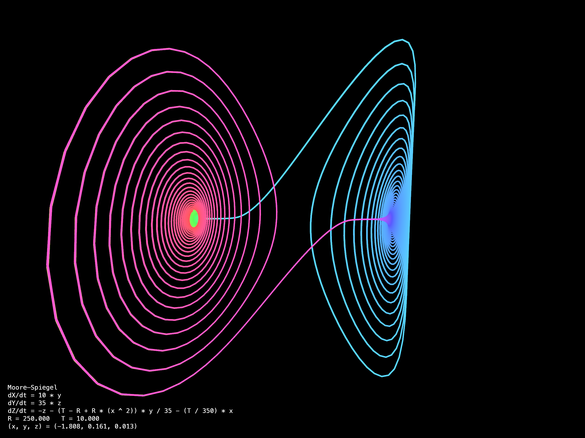 |
| **Спротт A** | `dx = y`<br>`dy = −x + yz`<br>`dz = 1 − y²` | фикс. | 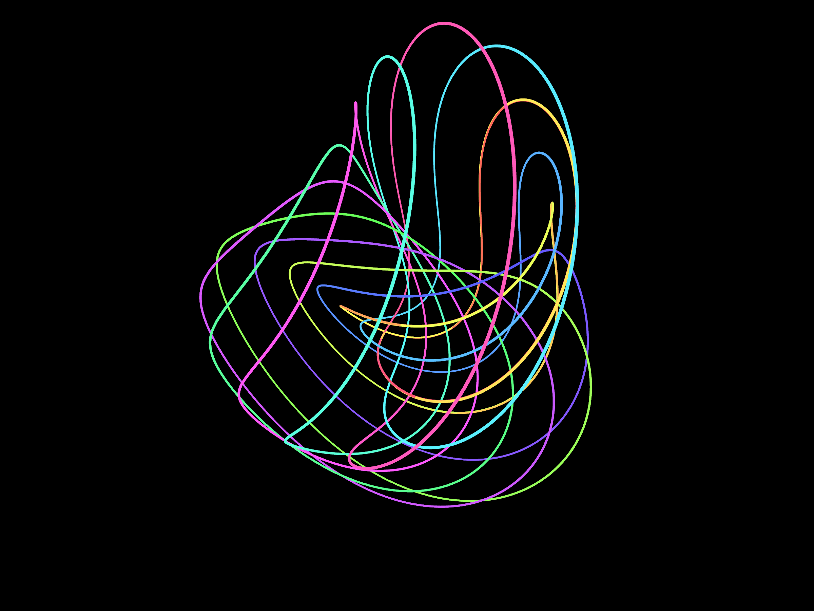 |
| **Спротт B** | `dx = yz`<br>`dy = x − y`<br>`dz = 1 − xy` | фикс. | 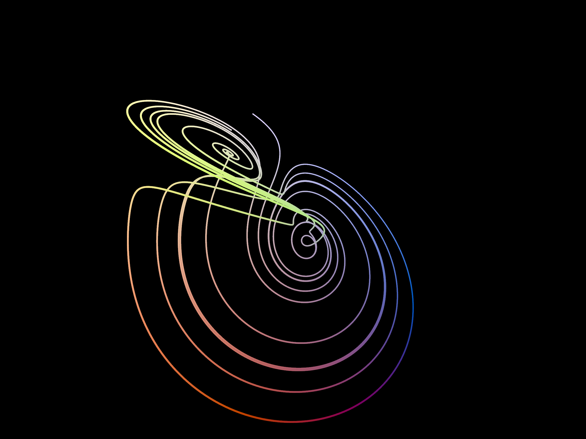 |
| **Спротт C** | `dx = yz`<br>`dy = x − y`<br>`dz = 1 − x²` | фикс. | 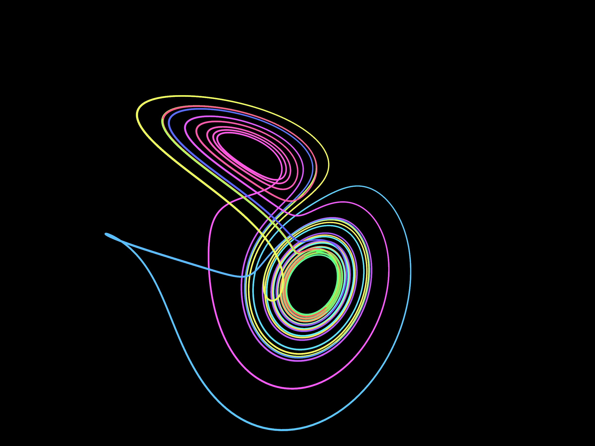 |

Параметры и гиперпараметры симуляции (шаг интегрирования, длина трейла, скорость камеры, скорость смены цвета) выбираются случайно из отобранных диапазонов в [`Core/Sources/AttractorCore/Resources/attractors.json`](Core/Sources/AttractorCore/Resources/attractors.json). Отбор проверен численно: каждая система тестировалась из нескольких случайных начальных состояний, а хаотические семейства с крошечными бассейнами притяжения (например, Sprott D–J, Рабиновича–Фабриканта) исключены — от случайных стартов они расходятся.

## Установка

### Из релиза (рекомендуется)

1. Скачайте `AttractorSaver.saver.zip` из последнего [релиза](https://github.com/xekchansky/strange-attractor-screensaver/releases) и распакуйте (Safari делает это сам).
2. Откройте `AttractorSaver.saver` двойным кликом — macOS предложит установить его в **Настройки системы → Обои → Заставка**. Либо скопируйте его в `~/Library/Screen Savers/`.
3. Выберите **AttractorSaver** в списке заставок.

Бандл подписан ad-hoc и не нотаризован, поэтому Gatekeeper может его заблокировать с сообщением «Apple не удалось подтвердить…». Перед установкой снимите карантинный флаг:

```bash
xattr -r -d com.apple.quarantine ~/Downloads/AttractorSaver.saver
```

(Если в PATH стоит Homebrew-версия `xattr` и падает с `bad interpreter`, вызывайте `/usr/bin/xattr`.) Альтернатива — **Настройки системы → Конфиденциальность и безопасность → Всё равно открыть** после первой заблокированной попытки. На macOS 26 бандл дополнительно обязан быть подписан (достаточно ad-hoc) — неподписанный `.saver` хост убивает с `Code Signature Invalid`.

### Сборка из исходников

Понадобятся macOS с Xcode (или Xcode Command Line Tools) и [xcodegen](https://github.com/yonaskolb/XcodeGen):

```bash
git clone https://github.com/xekchansky/strange-attractor-screensaver.git
cd strange-attractor-screensaver

# Юнит-тесты ядра (Xcode не требуется)
cd Core && swift test && cd ..

# Сборка и установка .saver-бандла
cd Host
xcodegen generate
xcodebuild -project AttractorHost.xcodeproj -scheme AttractorSaver \
  -configuration Release -derivedDataPath /tmp/host-dd build
mkdir -p ~/Library/Screen\ Savers
rm -rf ~/Library/Screen\ Savers/AttractorSaver.saver
ditto /tmp/host-dd/Build/Products/Release/AttractorSaver.saver \
      ~/Library/Screen\ Savers/AttractorSaver.saver
```

### Попробовать без установки: демо-приложение

Автономное демо позволяет запустить конкретный аттрактор с явными параметрами — удобно для исследования пространства параметров:

```bash
cd Demo && swift run AttractorDemo --attractor aizawa
```

Опции командной строки:

```text
-a, --attractor <id>       выбрать конкретный аттрактор (список — в --help)
-p, --param <имя>=<значение>  переопределить параметр (повторяемо, требует --attractor)
--step <v>                 шаг интегрирования
--speed <v>                множитель скорости симуляции
--cam-speed <v>            скорость вращения камеры
--trail-color-speed <v>    скорость смены цвета трейла
--trail-length <n>         длина трейла в точках
--color-mode <mode>        trail | age | depth | spatial
--screenshot <path>        снять один PNG прогретой сцены и выйти
--record <dir>             записать PNG-кадры (для сборки гифки) и выйти
--record-seconds <v>       длительность записи (по умолчанию 4)
--frame-stride <n>         снимать каждый n-й кадр (по умолчанию 2)
--capture-scale <n>        множитель разрешения снимка (по умолчанию 2)
--warmup-steps <n>         шагов интегрирования перед съёмкой (по умолчанию 60000)
--cam-azimuth <deg>        начальный азимут орбиты камеры (по умолчанию случайный)
--cam-elevation <deg>      высота камеры над горизонтальной плоскостью (по умолчанию 36)
--initial-state x,y,z      начальная точка интегрирования
```

## Как это устроено

```
attractors.json ──▶ AttractorCatalog ──▶ Randomizer ──▶ AttractorSelection
                                                              │
                                                              ▼
   SceneKit view ◀── TraceRenderer ◀── AttractorEngine ◀── AttractorModel
   (камера, трейл)                      ▲              (парсер формул в
                                        │                духе NSExpression)
                                  ODESolver (RK4)
```

- **`Core/`** — `AttractorCore`: чистый SPM-модуль без UI. Модель данных, парсер формул (рекурсивный спуск — `NSExpression` не умеет `sin`/`abs`), решатель RK4, движок с кольцевым буфером трейла, рандомизатор и сторожевой монитор, проверяющий каждое интегрированное состояние.
- **`Render/`** — `AttractorRender`: рендер на SceneKit — градиентная полилиния трейла, орбитальная камера с автокадрированием, оверлей формул. Общий для демо и заставки.
- **`Demo/`** — `AttractorDemo`: автономное AppKit-приложение для интерактивных запусков и headless-съёмки кадров (`--screenshot` / `--record`).
- **`Host/`** — таргеты заставки (классический `.saver` и вариант `.appex` для App Store), генерируются xcodegen.

Заставка пересоздаёт всю сцену, когда сторож обнаруживает неудачный запуск (например, траектория схлопнулась в точку или застряла в периодической петле), поэтому она никогда не замирает на сломанном кадре.

## Примечания и известные проблемы

- Собрано для Apple Silicon / Intel, macOS 13+.
- Установка неподписанных `.saver` на macOS 26 может подвесить глобальные горячие клавиши сессии (Cmd+Tab, переключение раскладки) до перезагрузки.

## Документация

- [README на английском](README.md)
- Скрипт съёмки документационных ассетов: [`docs/capture_all.sh`](docs/capture_all.sh)

## Лицензия

[MIT](LICENSE) © Khakayu Alexandr
